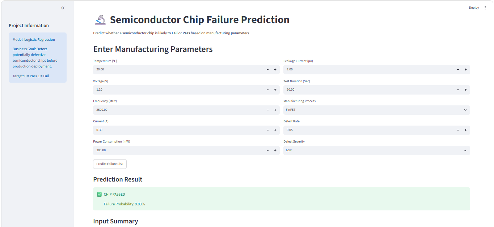

# Semiconductor Chip Failure Prediction

## Problem Statement

Predict semiconductor chip failures using manufacturing
and testing parameters.

## Project Architecture

┌─────────────────────────┐
│ Semiconductor Chip Data │
└────────────┬────────────┘
             │
             ▼
┌─────────────────────────┐
│        Data EDA         │
└────────────┬────────────┘
             │
             ▼
┌─────────────────────────┐
│ Data Preprocessing      │
│ • Missing Value Handling│
│ • Feature Engineering   │
└────────────┬────────────┘
             │
             ▼
┌─────────────────────────┐
│ ColumnTransformer       │
│ • Numerical Pipeline    │
│ • Ordinal Pipeline      │
│ • Nominal Pipeline      │
└────────────┬────────────┘
             │
             ▼
┌─────────────────────────┐
│ Logistic Regression     │
└────────────┬────────────┘
             │
             ▼
┌─────────────────────────┐
│ Prediction Model        │
│ best_model.pkl               │
└────────────┬────────────┘
             │
             ▼
┌─────────────────────────┐
│ Streamlit Application   │
└─────────────────────────┘

## Dataset Information

Features:
- Temperature
- Voltage
- Frequency
- Current
- Power Consumption
- Leakage Current
- Test Duration
- Defect Severity
- Manufacturing Process

Target:
- Failure / Non-Failure

## Exploratory Data Analysis

View the complete EDA notebook here:

[EDA Notebook](../Notebooks/01_preprocessing_EDA.ipynb)

## Data Preprocessing

- Missing Value Handling
- Feature Scaling
- Ordinal Encoding
- One Hot Encoding
- ColumnTransformer

## Machine Learning Pipeline

- SimpleImputer
- StandardScaler
- OrdinalEncoder
- OneHotEncoder
- ColumnTransformer
- Logistic Regression

## Model Evaluation

A

## Streamlit Application

## How to Run

pip install -r requirements.txt

streamlit run streamlit_app.py